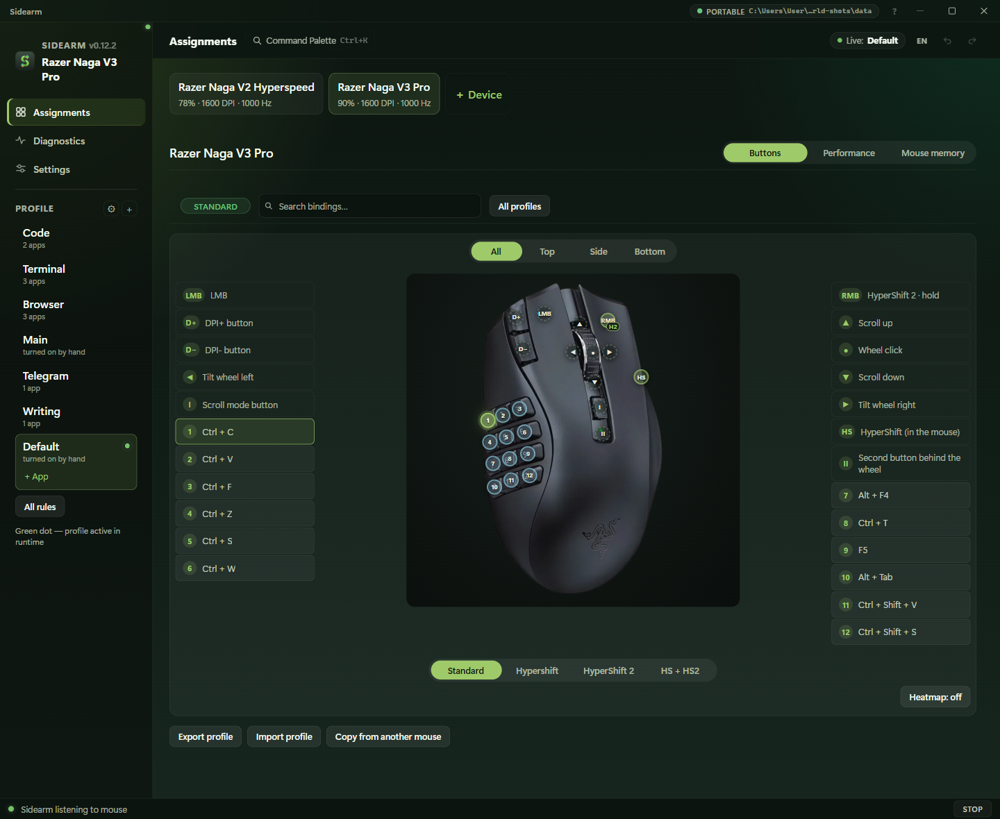
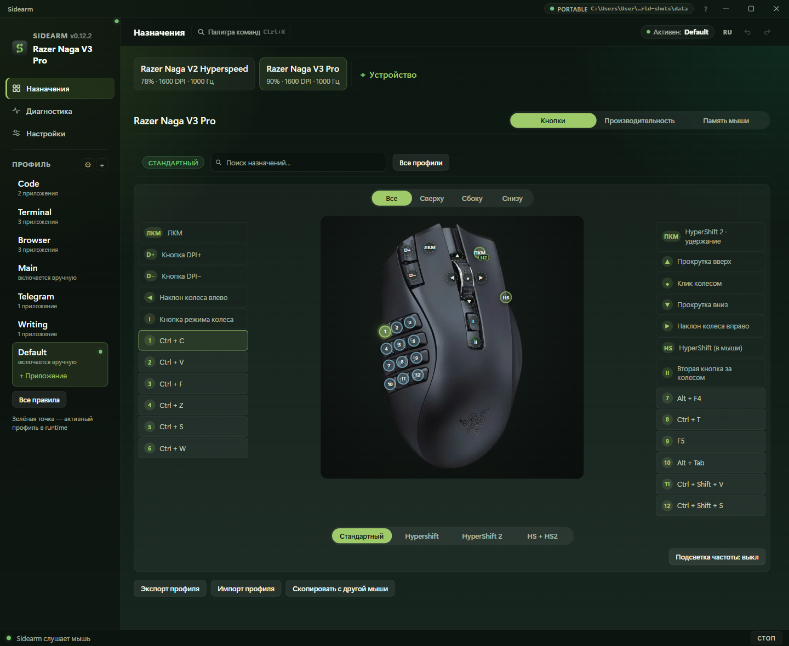

<div align="center">

# Sidearm

**An open-source Razer Synapse alternative for the Razer Naga V2 HyperSpeed and Naga V3 Pro.**

Configure every button, Hypershift, DPI, polling rate and battery of your Naga
without installing Razer Synapse — plus per-app profiles, macros and text snippets
that Synapse never had.

[](LICENSE)
[](#requirements)
[](https://v2.tauri.app)
[](https://github.com/danscMax/Sidearm/releases/latest)

[**English**](#replace-razer-synapse) | [**Русский**](#замена-razer-synapse)

</div>

---

## Replace Razer Synapse

Sidearm talks to the mouse directly over its vendor HID protocol and writes the
button layout into the mouse's **onboard memory** — the same thing Synapse does,
without Synapse, Razer Central or any Razer background service. You can uninstall
Synapse completely.

### What Sidearm already replaces

| Synapse feature | Sidearm |
|---|---|
| Remap the 12 thumb buttons, top buttons, wheel, Mouse 4/5 | ✅ written into the mouse's onboard memory |
| Hypershift (second layer while a button is held) | ✅ any trigger button: right / left / wheel click / Mouse 4 / Mouse 5 |
| Keyboard shortcuts on buttons | ✅ including modifier-only holds (push-to-talk Alt+Shift) |
| Macros | ✅ with timing, text and launch steps — more than Synapse |
| DPI and polling rate (125 / 500 / 1000 Hz) | ✅ per profile, applied on profile switch |
| Battery level | ✅ in the app, as a badge on the tray icon, low-battery warning (< 10 %, once a day) |
| Buttons keep working with the app closed | ✅ on exit the chosen profile is stored in the mouse: keys, shortcuts, mouse buttons and the Hypershift layer work without Sidearm |
| Profiles per application | ✅ automatic switching by the foreground window (Synapse needs a game library for this) |
| Import your Synapse setup | ✅ import of Synapse profiles |
| Protection against Razer software | ✅ a guard notices when Razer software overwrites the mouse and puts your layout back |

### Not supported yet

- Firmware updates and wireless dongle pairing — still need Razer's own tools.
- Horizontal scroll (wheel tilt) under Hypershift while Sidearm is **closed** — the
  mouse has no onboard record for tilt. It works while Sidearm runs.
- Text snippets, macros and app launches only run while Sidearm runs (the mouse
  firmware can only play keys and mouse buttons on its own).

### More than Synapse

| Feature | Description |
|---|---|
| **9 action types** | Shortcut, mouse action, text snippet, macro, app launch, media key, profile switch, context menu, disable |
| **Per-app profiles** | Excel, VS Code, the browser — each gets its own layout, switched automatically |
| **Snippet library** | Reusable text snippets shared between buttons |
| **Live diagnostics** | Press a button and see how it resolves: window → profile → binding → action |
| **Heatmap** | Which buttons you actually use |
| **On-screen notifications** | Profile switches shown in a corner of the screen |
| **Portable** | One folder, no installer, settings stored next to the exe |

### Supported devices

- **Razer Naga V2 HyperSpeed** — full native support (onboard memory, DPI, polling rate, battery).
- **Razer Naga V3 Pro** (2.4 GHz receiver, 12-button side plate) — full native support:
  side and top buttons, wheel, the HyperShift button under the ring finger, DPI, battery,
  and its onboard profile slots — each Sidearm profile can be saved into a slot on exit.
  Works together with a V2 HyperSpeed: each mouse keeps its own HyperShift layer, and
  assignments can be copied from one mouse to the other.
- **Razer Naga V2 Pro, Naga Pro, Naga X** — recognised: DPI, polling rate and battery
  work, the buttons work as a custom device. **Own one?** Press **Help verify** on the
  mouse's Performance tab: Sidearm reads the mouse (without changing it) and opens a
  [Device Report](https://github.com/danscMax/Sidearm/issues/new?template=device_report.yml)
  — that report is how the model gets full support.
- **Any other mouse, keyboard or macro pad that sends keys** — add it as a custom
  device: Sidearm learns each button by its signal and maps it like the Naga's.

### Roadmap

- Native support for more mice — other Razer Naga models (Naga V2 Pro, Naga Pro,
  Naga X…), then other Razer mice and other brands — with the same onboard-memory,
  DPI and battery control.
- Device-specific settings pages for every supported model.



---

## Installation

1. Download `Sidearm-Portable-vX.Y.Z.zip` from [Releases](https://github.com/danscMax/Sidearm/releases/latest).
2. Unpack it anywhere and run `Sidearm.exe`.
3. On first start the onboarding writes the button layout into your Naga.

Razer Synapse is **not** required. If it is installed, quit it and turn off its
autostart: while it runs it rewrites the mouse.

### Requirements

- **Windows 10** (1809+) or **Windows 11**
- **WebView2 Runtime** (built into Windows 11; for Windows 10 the installer is in `resources/`)

---

## Building from source

```bash
# Requirements: Node.js 20+, Rust (stable), Windows 10/11
git clone https://github.com/danscMax/Sidearm.git
cd Sidearm
npm install
npm run tauri dev                      # development
pwsh -File build_portable.ps1          # portable release build
```

## Architecture

```
Button press
  -> the mouse plays the record from its onboard memory (written by Sidearm)
  -> low-level hook catches Sidearm's signal
  -> resolver: foreground window -> profile -> button -> layer -> binding
  -> executor: keystrokes / text / app launch / macro
```

| Layer | Technology |
|---|---|
| Backend | Rust, `windows-sys`, vendor HID feature reports, low-level hooks |
| Frontend | React 19, TypeScript, Vite |
| Framework | Tauri v2 |

---

<div align="center">

## Замена Razer Synapse

</div>

**Sidearm — открытая альтернатива Razer Synapse для Razer Naga V2 HyperSpeed и Naga V3 Pro.**
Настраивает все кнопки, Hypershift, DPI, частоту опроса и заряд мыши без
установленного Razer Synapse. Плюс профили под приложения, макросы и текстовые
сниппеты, которых в Synapse нет.

Sidearm общается с мышью напрямую по её служебному HID-протоколу и записывает
раскладку кнопок во **встроенную память мыши** — так же, как Synapse, но без
Synapse, Razer Central и фоновых служб Razer. Synapse можно удалить полностью.

### Что Sidearm уже заменяет

| Функция Synapse | Sidearm |
|---|---|
| Переназначение 12 боковых, верхних кнопок, колеса, Mouse 4/5 | ✅ записывается во встроенную память мыши |
| Hypershift (второй слой, пока зажата кнопка) | ✅ любая кнопка-триггер: правая / левая / колесо / Mouse 4 / Mouse 5 |
| Сочетания клавиш на кнопках | ✅ включая удержание одних модификаторов (push-to-talk Alt+Shift) |
| Макросы | ✅ с задержками, вставкой текста и запуском программ — больше, чем в Synapse |
| DPI и частота опроса (125 / 500 / 1000 Гц) | ✅ свои для каждого профиля |
| Заряд батареи | ✅ в приложении, значком на иконке в трее, предупреждение при заряде ниже 10 % (раз в сутки) |
| Кнопки работают при закрытой программе | ✅ при выходе выбранный профиль записывается в мышь: клавиши, сочетания, кнопки мыши и слой Hypershift работают без Sidearm |
| Профили под приложения | ✅ автоматически по активному окну |
| Импорт настроек Synapse | ✅ импорт профилей Synapse |
| Защита от ПО Razer | ✅ если ПО Razer перезапишет мышь, Sidearm заметит и вернёт вашу раскладку |

### Пока не поддерживается

- Обновление прошивки и привязка беспроводного донгла — нужны утилиты Razer.
- Горизонтальная прокрутка (наклон колеса) на Hypershift при **закрытом** Sidearm —
  у мыши нет для наклона записи в памяти. С запущенным Sidearm работает.
- Текстовые сниппеты, макросы и запуск программ работают только с запущенным
  Sidearm (сама мышь умеет только клавиши и кнопки мыши).

### Поддерживаемые устройства

- **Razer Naga V2 HyperSpeed** — полная поддержка (память мыши, DPI, частота опроса, заряд).
- **Razer Naga V3 Pro** (приёмник 2,4 ГГц, панель на 12 кнопок) — полная поддержка: боковые и
  верхние кнопки, колесо, кнопка HyperShift под безымянным пальцем, DPI, заряд и слоты
  профилей в памяти мыши — каждый профиль Sidearm можно сохранить в слот при выходе.
  Работает вместе с V2 HyperSpeed: у каждой мыши свой слой HyperShift, назначения можно
  скопировать с одной мыши на другую.
- **Razer Naga V2 Pro, Naga Pro, Naga X** — распознаются: DPI, частота опроса и заряд
  работают, кнопки — как у своего устройства. **Есть такая мышь?** Нажмите
  **«Помочь проверить»** на вкладке мыши «Производительность»: Sidearm прочитает мышь (ничего не меняя) и
  откроет [отчёт об устройстве](https://github.com/danscMax/Sidearm/issues/new?template=device_report.yml)
  — по нему модель получит полную поддержку.
- **Любая другая мышь, клавиатура или макропад, которые шлют клавиши** — добавляются
  как своё устройство: Sidearm запоминает каждую кнопку по её сигналу.

### В планах

- Полная поддержка других мышей — других Razer Naga (Naga V2 Pro, Naga Pro, Naga X…),
  затем других мышей Razer и других производителей — с такой же записью в память,
  DPI и зарядом.
- Отдельные страницы настройки для каждой поддерживаемой модели.



### Установка

1. Скачайте `Sidearm-Portable-vX.Y.Z.zip` из [Releases](https://github.com/danscMax/Sidearm/releases/latest).
2. Распакуйте в любую папку и запустите `Sidearm.exe`.
3. При первом запуске мастер запишет раскладку кнопок в Naga.

Razer Synapse **не нужен**. Если он установлен — закройте его и отключите
автозапуск: пока он работает, он перезаписывает мышь.

**Требования:** Windows 10 (1809+) или Windows 11, WebView2 Runtime (встроен в
Windows 11; для Windows 10 установщик лежит в `resources/`).

---

<div align="center">

## License

[MIT](LICENSE)

<sub>Keywords: Razer Synapse alternative, replace Razer Synapse, Razer Naga V2 HyperSpeed software,
Naga button remapping without Synapse, альтернатива Razer Synapse, замена Synapse, программа для Razer Naga.</sub>

</div>
